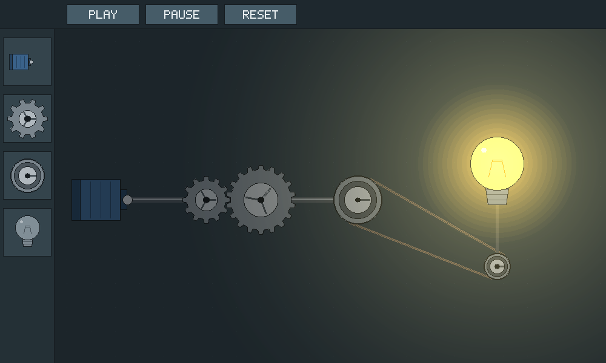
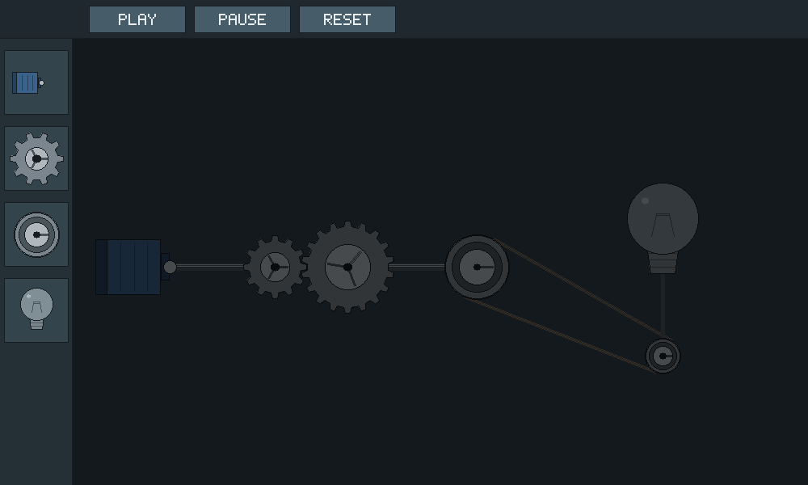

# Lumina Gear

A 2D Mechanical Power and Illumination Simulator (Computer Graphics group project).

Users build a machine from a motor, gears, pulleys and a lightbulb. When power
reaches the bulb, the dark room brightens and the bulb gives off a soft glow.

## Checkpoint 1: Technical Foundation

CP1 is written in **pure C++17**. There is no graphics library: every pixel is
written to our own framebuffer by algorithms we wrote, and the result is saved
as a BMP image.

| Technique | Where | Used for |
|---|---|---|
| Bresenham line algorithm | `src/line.cpp` | belts, shafts, outlines, spokes, filament |
| Midpoint circle algorithm | `src/circle.cpp` | pulleys, hubs, bulb, glow rings |
| Scanline polygon fill (even-odd rule) | `src/polygon.cpp` | gear bodies, motor, buttons, toolbar |
| Alpha blending | `src/framebuffer.cpp`, `src/effects.cpp` | glow around the bulb |
| Raster operation (darkness overlay with additive light) | `src/effects.cpp` | dark room that the bulb "pierces" |
| Point-in-Circle picking | `include/lumina/picking.h` | detecting a click on a part |

| Powered | Unpowered |
|---|---|
|  |  |

## Build and run

You need a C++17 compiler and CMake 3.10 or newer.

**Windows (Visual Studio or Build Tools):**

```bash
cmake -S . -B build
cmake --build build --config Release
build\Release\lumina_gear.exe
```

**Windows (MinGW) or Linux or macOS:**

```bash
cmake -S . -B build
cmake --build build
./build/lumina_gear
```

The program writes two images in the folder you run it from:
`lumina_gear_cp1_powered.bmp` and `lumina_gear_cp1_unpowered.bmp`.

## Run the tests

```bash
cd build
ctest --output-on-failure
```

(With Visual Studio add `-C Release`.) The tests compare our circle, line and
polygon algorithms against independent reference calculations, and also check
picking, gear meshing, blending and the user interface hit areas.

## Documentation

- `docs/CODE-GUIDE.md`: what to install, how to run in VS Code, and what every file does.
- `docs/git-workflow.md`: team Git rules.

## Project layout

```
include/lumina/   headers (framebuffer, line, circle, polygon, picking,
                  components, belt, ui, effects, scene)
src/              implementations and main.cpp
tests/            self-checking tests (no test library needed)
docs/             notes and screenshots
```

## Notes for the next checkpoints

- `Component::angle` is already used when drawing gears and pulleys, so CP2 only
  needs to change the angle each frame (and add translation for dragging).
- `meshAngle()` gives the starting angle that lets two gears mesh. Gears use a
  fixed module (`kGearModule`), so any two gears fit together at a centre
  distance of `gearPitchRadius(a) + gearPitchRadius(b)`.
- Gear ratio: output speed = input speed x (input teeth / output teeth).
- `Light` and `applyDarkness()` take an intensity from 0 to 1. In CP2 this
  value should come from the power that reaches the bulb.

## Team workflow

See `docs/git-workflow.md` for the branch and Pull Request rules (`docs/project-lead-guide.md` is for the project lead).
